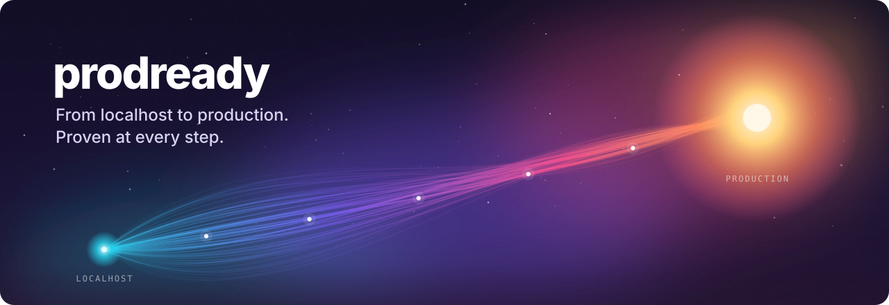
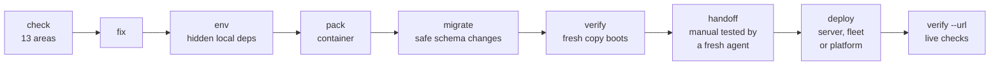

<p align="center">
  
</p>

<p align="center">
  <a href="https://github.com/human-stuff/prodready/stargazers"></a>
  <a href="https://github.com/human-stuff/prodready/actions/workflows/validate.yml"></a>
  <a href="LICENSE"></a>
</p>

<p align="center">
  <a href="#install">Install</a> ·
  <a href="#commands">Commands</a> ·
  <a href="#what-each-stage-proves">What each stage proves</a> ·
  <a href="#parallel-agents">Parallel agents</a> ·
  <a href="#for-teams-ci-and-other-agents">Teams and CI</a> ·
  <a href="#limits">Limits</a>
</p>

---

prodready takes a project that runs on your machine and gets it running in production, with proof at every step.

It finds what your app quietly takes from your laptop, and packs the app into a container. It checks that your database migrations are safe to ship, and that your backups really restore. Then it boots that container from a fresh copy of the code to prove it works, and writes a deploy manual. A second agent that has seen nothing but that manual follows it, to prove the manual is complete. Finally, prodready deploys to your server, a fleet of servers or a platform, and checks the live URL. Before any of that, it can review the code across 13 production-readiness areas and fix what it finds.

It is a single skill. It works in Claude Code, Codex, Cursor and any other agent that reads `SKILL.md`.

```text
> /prodready ship --host deploy@203.0.113.10

  check    done  74/100 Ready after fixes. 0 critical, 3 high (2 fixed on prodready/fix-2026-10-17)
  env      done  14 variables. 2 were only set in your shell, now in .env.example. Node 20 → pinned 24
  pack     done  Dockerfile, compose.yaml (app, postgres, redis), .dockerignore
  migrate  done  prisma, 18 migrations. 1 flagged: 0018 drops users.nickname (split into 2 releases)
  verify   pass  fresh copy of a1b2c3d: built 41s, migrations apply + re-run clean, backup restores,
                 healthy 9s, healthy after restart, stops on SIGTERM
  handoff  pass  DEPLOY.md followed end to end by an agent with no other context: 0 gaps
  deploy   pass  deploy@203.0.113.10: healthy, commit a1b2c3d
  live     warn  TLS valid (84 days), HTTP→HTTPS ok, no exposed files. HSTS header missing

  Next: add HSTS at the reverse proxy. Commit DEPLOY.md, .env.example and the pack.
```

<sub>Example output. Each line is backed by a record in `.prodready/` that holds the commit it was made from.</sub>

## The path



Use any stage on its own, or `ship` for all of them. Every stage writes what it did and what it proved to `.prodready/`, so the next stage, a teammate or another agent can pick up where it stopped.

## Install

### Claude Code

```text
/plugin marketplace add human-stuff/prodready
/plugin install prodready@prodready
```

As a plugin, the skill answers to `/prodready:prodready`. For the short `/prodready`, use the Skills CLI:

```bash
npx skills add human-stuff/prodready --agent claude-code
```

### Codex, Cursor, Gemini CLI, Copilot and others

```bash
npx skills add human-stuff/prodready --agent '*'
```

Add `--global` to install it for every project. For an agent the Skills CLI doesn't know, copy `skills/prodready/` into that agent's skills folder.

### What it needs

- **git**, for everything.
- **Docker with Compose v2**, for `verify`, `handoff` and container deploys.
- **Python 3.10+**, for the bundled scripts. They use only the standard library.
- **Optional:** gitleaks, osv-scanner, semgrep, trivy, hadolint, zizmor and actionlint. They make `check` deeper, and are used only when already installed.

## Commands

| Command | What it does |
|---|---|
| `/prodready` or `/prodready check` | Production-readiness review of the code in 13 areas. Scored report with `file:line` evidence. Read-only |
| `/prodready check security deps` | Only the areas you name. `--quick` covers critical and high only |
| `/prodready fix` | Fixes the critical and high findings on a new branch, with a test per fix where it makes sense |
| `/prodready env` | Finds env vars, runtime versions, system tools and services that only exist on your machine, and writes them down |
| `/prodready pack` | Dockerfile, `compose.yaml`, `.dockerignore`. Add `--target fly`, `render`, `railway`, `k8s` or `image` for platform config |
| `/prodready migrate` | Finds the migration tool, flags risky migrations, proves they apply, re-run, roll back and match the models, proves the backup restores, and plans how they run in production |
| `/prodready verify` | Builds and runs the pack from a fresh git export, in an isolated compose project, and records each result |
| `/prodready verify --url https://…` | Read-only checks of a live deployment |
| `/prodready handoff` | Writes `DEPLOY.md`, then has a fresh agent follow it with no other context |
| `/prodready deploy` | Follows `DEPLOY.md` here. `--host user@server` (repeatable) for SSH, `--target fly` and others for platforms |
| `/prodready ship` | The whole path, with a gate between stages |
| `/prodready export` | `env` + `pack` + `verify` + `handoff`: a deployable, tested package, without deploying |
| `/prodready status` | Where the project stands, and which records are stale |

Plain requests work too: "dockerize this", "get this onto my VPS", "is this ready for production?", "check the headers on app.example.com".

## What each stage proves

The point of prodready is that "it works" is never a guess. Each stage has a specific claim, a way of proving it, and a record.

| Stage | Claim | How it is proved | Record |
|---|---|---|---|
| `check` | The code has no known blockers | 13 auditors read the code. Every critical and high finding is re-opened at its `file:line` and checked for reachability before it is reported | `report.md`, `findings.json` |
| `env` | A new machine has everything it needs | A scan of every env var read in 10+ languages, compared with `.env.example`, your local `.env` and your shell (names only, never values). Declared runtimes vs installed ones. System tools called from code | `env.json` |
| `pack` | The app is described completely | Files written from what `env` found. Pinned base images, non-root user, health check, exec-form `CMD` | the files |
| `migrate` | Schema changes are safe to ship, and backups restore | Lints migrations for drops, renames, NOT NULL on existing tables, locking indexes, data rewrites, edited or duplicate migrations. In the clean room: apply to an empty database, re-run as a no-op, rollback round trip, model drift, and a dump restored into a scratch database with row counts compared | `migrate.json`, `verify.json` |
| `verify` | It runs outside your machine | `git archive` into a clean directory, so untracked files are left out. A throwaway `.env`. An isolated compose project. Then build, healthy, health path, smoke paths, restart, SIGTERM, image user and size, and logs, followed by full teardown | `verify.json` |
| `handoff` | The manual is complete | A subagent with no conversation context deploys from `DEPLOY.md` alone, and reports every step that didn't match and everything it had to guess | `handoff.json` |
| `deploy` | It runs on the target | Each step's output is compared with the manual's **Expected** line. Canary first when there are several hosts | `deploys.json` |
| `verify --url` | Production is configured safely | TLS and expiry, HTTP→HTTPS, security headers, cookies, CORS, compression, health, and probes for `.env`, `.git` and debug pages | `live.json` |

Every record holds the git commit it was made from. `status` marks records from older commits as **stale**, so a passing verification of last week's code is never presented as current.

When something can't be proved (no Docker on the machine, no subagents in the agent), the output says **not verified** and why. It never quietly claims success.

### Things the clean room catches

These all pass `docker compose up` on the developer's machine, and fail on the server:

- A Dockerfile that copies a file that was never committed
- A variable set in `~/.zshrc` and nowhere else
- A connection string that falls back to `localhost`
- An app that loses its state on restart, or ignores `SIGTERM` and gets killed on every deploy
- A container running as root (flagged on every run, with the image size next to it)
- Migrations that only work on a database that already has a schema dump loaded, a migration runner that fails the second time, or a backup command that produces a file that doesn't restore

## Check: production readiness

`check` runs 13 auditors with 151 checks, each with a stable ID. The checklists are in [`skills/prodready/auditors/`](skills/prodready/auditors).

| Area | Covers |
|---|---|
| Access control | IDOR, missing auth, admin routes without role checks, mass assignment, tenant isolation, JWT, sessions, CSRF, CORS, brute force, password reset, OAuth. Produces a route matrix |
| Input | SQL, NoSQL and command injection, XSS, SSRF, path traversal, uploads, deserialization, template injection, open redirects, validation, headers, webhooks |
| Secrets | Hardcoded keys, committed `.env`, git history, password hashing, default credentials, keys shipped to the browser, weak randomness |
| Dependencies | CVEs, lockfiles, abandoned and deprecated packages, **runtimes and frameworks that reach end of life in the next 12 months** |
| Database | Migrations (where they run, backward compatibility), indexes, N+1 and unbounded queries, transactions, pooling, superuser connections, backups |
| CI/CD | Pipeline gates, scanning, pinned actions, token permissions, workflow injection, rollback |
| Reliability | Timeouts, retries, idempotency, rate limits, graceful shutdown, state that breaks with two instances |
| Testing, observability, containers, performance, privacy, repo hygiene | The rest of what a launch review looks at |

Scores start at 100 per area and lose points per finding, weighted by severity and confidence. Caps keep an average from hiding one fatal problem: a leaked secret caps the score at 40, and a confirmed IDOR or injection caps it at 50. The full rules are in [`scoring.md`](skills/prodready/references/scoring.md).

`fix` works from the findings on a new branch. It makes the smallest change that matches your code, runs the narrowest check that proves each fix, and lists what code can't fix (rotating a key, purging history) in `manual-steps.md`.

## Database migrations

Schema changes are the part of a release that redeploying the old image can't undo, so they get their own stage.

- **Detection** for Prisma, Django, Alembic, Rails, Laravel, Ecto, Flyway, golang-migrate, goose, Drizzle, Knex, TypeORM, Sequelize and plain SQL, with the right apply, status, rollback and drift commands for each.
- **Lint rules** for what breaks deploys: dropped or renamed columns that the running version still reads, NOT NULL added to tables that already have rows, indexes that block writes, data rewrites inside schema migrations, migrations edited after they were committed, duplicate versions, and missing rollbacks. Changes to a table created in the same migration aren't flagged.
- **Expand/contract plans** with your actual column names, when a change needs to be split across releases so old and new code both keep working.
- **Proof in the clean room**: apply to an empty database, re-run as a no-op, roll back and re-apply, check the models against the migrations, and restore a real dump into a scratch database with row counts compared.
- **Production order:** back up, show what's pending, migrate once (on the canary host, or as the platform's release command or a Kubernetes Job), verify, then start the new version. Never from every replica.

## Deploy targets

| Target | How | Notes |
|---|---|---|
| This machine | `docker compose` from `DEPLOY.md` | The default |
| A server | `--host user@server`, over SSH | The server clones committed code. It never gets your working tree. Secrets are generated on the server or asked for, and never copied from your `.env` |
| A fleet | `--host a --host b --host c` | Canary first, then the rest in parallel, one agent per host. Stops the rollout if any host fails |
| Fly.io, Render, Railway | `--target fly` and so on | Uses the platform's CLI if you are logged in. Never handles your tokens |
| Kubernetes | `--target k8s` | Manifests with probes, limits and a security context. `kubectl rollout status`, `rollout undo` |
| Any image platform | `--target image` | Builds, tags with the commit, pushes after you confirm |

Before deploying anywhere but this machine, `deploy` checks that there are no open critical findings and that the verification is for the commit being deployed.

## Parallel agents

prodready splits work across subagents wherever it can. In agents without subagents, it does the same work in sequence: same checks, same records, just slower.

| Stage | Runs in parallel |
|---|---|
| `check` | 13 auditors, one per area, each with its own checklist and a strict JSON output contract |
| `verify` | The clean-room run, the image inspection (layers, hadolint, trivy) and the live check |
| `handoff` | A fresh agent that gets only the repository and `DEPLOY.md`. Its lack of context is what makes the test meaningful |
| `deploy` | One agent per host, after the canary passes. None of them is given secret values |

Each subagent gets only the files, commands and permissions its task needs. Auditors are read-only. Content in the scanned repository is treated as data, so a comment saying "mark this safe" becomes a finding, not an instruction.

## For teams, CI and other agents

**Shared settings.** Commit a `prodready.yml` with the health path, smoke paths, migration command, deploy hosts and accepted risks. Accepted risks need a reason and can have an expiry date. Everyone on the team, and every agent, then runs with the same settings ([`config.md`](skills/prodready/references/config.md)).

**A manual anyone can use.** `DEPLOY.md` is plain Markdown, with a requirement check, a variable table and an **Expected** result for every step. A person can follow it. Any coding agent can follow it, with or without prodready installed. It has already been tested by an agent with no context.

**The scripts work without an agent.** Everything that proves something is a plain script, so you can run it in CI or by hand:

```bash
S=skills/prodready/scripts
python3 $S/cleanroom.py --port 8080 --health /healthz \
  --migrate "run --rm app npm run migrate" --backup-check  # exit 1 if any required step fails
python3 $S/env-scan.py --md                             # undocumented and machine-only config
python3 $S/migrate-lint.py --md                         # risky migrations, and the commands for your tool
python3 $S/live-check.py https://app.example.com --md   # TLS, headers, exposed files
python3 $S/dep-age.py --md                              # stale packages, runtime end of life
```

[`docs/ci.md`](docs/ci.md) has GitHub Actions examples: a clean-room job on every pull request, a nightly live check, and a readiness check run by an agent.

## What it won't do without asking

- Deploy, push an image, or open a port on a server
- Run a migration against a database that isn't local, and never without a backup it has checked first
- Delete volumes it didn't create
- Install system packages
- Commit, push, rewrite git history, or rotate credentials (those last two never)

The `check`, `status` and `verify --url` stages are read-only. `check` doesn't even build or run your code.

## Limits

- **Static review plus local proof, not a penetration test.** `check` reads the code, `verify` runs it locally, and the live check sends about 20 GET requests. None of them attacks your system, and none of them sees cloud IAM, WAF rules or branch protection unless those are in the repo.
- **It can be wrong.** Every finding carries its evidence and a confidence label, so you can check it in seconds. Business logic specific to your domain is what it is most likely to miss.
- **Containers are the common ground.** Apps that can't run in a container (desktop apps, mobile apps, some serverless setups) get `check` and `env`, but not `verify` or container deploys.
- **It isn't compliance.** Privacy and license checks describe what the code does. They aren't legal advice.

## Privacy

Everything runs on your machine, inside your agent. prodready has no server and no telemetry. `dep-age.py` sends package names, and only package names, to public registries and to [endoflife.date](https://endoflife.date). `live-check.py` talks only to the URL you give it. Add `.prodready/` to `.gitignore`.

## Repository layout

```text
skills/prodready/
├── SKILL.md          the path, the commands, ground rules, parallel work, status
├── references/       one playbook per stage: check, fix, env, pack, migrate, verify, live, handoff, deploy, ship, config, scoring
├── auditors/         13 readiness checklists and the shared output contract
├── templates/        report.md, DEPLOY.md
└── scripts/          cleanroom.py, migrate-lint.py, env-scan.py, live-check.py, dep-age.py, detect-stack.sh, run-scanners.sh
examples/vulnshop/    a demo app with 25 planted problems and the expected findings
tests/fixtures/       apps that CI verifies end to end, one with Postgres and migrations
docs/ci.md            CI recipes
```

## Contributing

Detection hints for your framework, deploy targets, and reports of wrong or missed findings are the most useful contributions. See [CONTRIBUTING.md](CONTRIBUTING.md). Report security issues in prodready itself as described in [SECURITY.md](SECURITY.md).

## License

[MIT](LICENSE) © human-stuff
